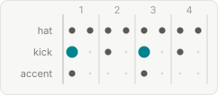
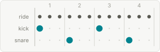
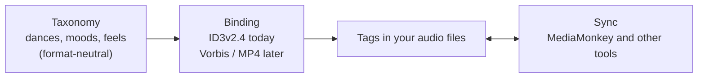

# SocialDanceTaggingStandard

[](https://github.com/rokbjc/SocialDanceTaggingStandard/actions/workflows/ci.yml) [](https://rokbjc.github.io/SocialDanceTaggingStandard/) [](LICENSE) [](LICENSE-SPEC)

Reference library for the **Social-Dance Tagging Standard (SDTS)** — a tag standard for
social/partner-dance DJ music libraries (swing and blues first, with room for the wider
social-dance world).

### 📖 [Read the documentation →](https://rokbjc.github.io/SocialDanceTaggingStandard/)

No programming needed: the site explains the model in plain language and lists every dance, mood and
groove, with a page for each field.

## The problem

A dance DJ needs to know *what a track is for*, not just what genre it is. Normal tags can't say that.

| | Ordinary tags | With SDTS |
|---|---|---|
| Genre | `Misc` | `Swing` |
| Dance | — | `Lindy Hop` |
| Rhythmic feel | — | `Jump Shuffle` |
| Mood | — | `Joyful; Playful` |
| Energy (1–10) | — | `8` |
| Intro until the groove starts | — | `12000` ms |

*(Invented example track. Field names, values and aliases are listed in the
[vocabulary](https://rokbjc.github.io/SocialDanceTaggingStandard/model/vocabulary/); `energy` and
`intro_duration` are still `proposed` fields.)*

### Same tempo, different groove

Two tracks at the same BPM can be different dances. The *feel* is what tells them apart:

| Straight 4 | Shuffle | Jump Shuffle |
|---|---|---|
|  |  |  |

## How it fits together



> [!NOTE]
> **Early — seeking feedback.** SDTS is a **draft standard** (spec `0.1.0-draft`, pre-1.0) published for
> review: the field set and vocabulary may still change before the first stable release. Feedback is very
> welcome — open an [issue](https://github.com/rokbjc/SocialDanceTaggingStandard/issues) or start a
> [discussion](https://github.com/rokbjc/SocialDanceTaggingStandard/discussions). The NuGet packages are **not published yet**;
> they will be if the standard finds an audience. Until then, build from source.

## 💬 Tell us how you tag

The standard improves with real practice. If you DJ or teach social dance, tell us which properties you
tag, which values you use, and what you cannot say yet: start a thread in
[**How do you tag?**](https://github.com/rokbjc/SocialDanceTaggingStandard/discussions/categories/how-do-you-tag).
A missing dance, mood or field can also go in as an [issue](https://github.com/rokbjc/SocialDanceTaggingStandard/issues/new/choose).

## Two layers (a binding model)

1. **Taxonomy (format-neutral)** — what dances and per-track dimensions exist, and the rules for them.
   Split across two dependency-light packages: the `SocialDanceTaggingStandard` core (the standard surface + the
   `Sync/` reconcile engine, no value data) and `SocialDanceTaggingStandard.Taxonomy` (the normative baseline
   vocabulary + loader + alias/value resolution). The values are hand-maintained in `data/vocabulary/`,
   edited directly via PR.
2. **Serialization bindings** — how that taxonomy maps to a concrete tag container. The first target is
   **ID3v2.4** (`SocialDanceTaggingStandard.Id3`): the `SdtsFile` typed gateway reads/writes a whole SDTS record in one
   open→save cycle, and the low-level `ISdtsSource` frame sources remain for advanced use. Future
   `SocialDanceTaggingStandard.Vorbis` / `.Mp4` reuse the same field names via the cross-format triangle
   (`TXXX:X` = Vorbis `X` = MP4 `----:com.apple.iTunes:X`).

## Quick start

The packages are not on NuGet yet, so reference the project from a clone:

```bash
git clone https://github.com/rokbjc/SocialDanceTaggingStandard.git
dotnet add reference SocialDanceTaggingStandard/dotnet/src/SocialDanceTaggingStandard.Taxonomy
```

```csharp
using SocialDanceTaggingStandard.Taxonomy;

var vocab  = SocialDanceVocabulary.LoadDefault();   // compiled-in baseline vocabulary — no file I/O or network needed
var dances = vocab.Dances("swing");                  // the swing pack's dance dimension
var lindy  = dances.Resolve("#LH");                  // resolve an alias to its canonical term
Console.WriteLine(lindy?.Canonical);                 // → "Lindy Hop"
```

From here: validate a value (`dimension.Contains`), normalize a list to canonical terms
(`dimension.Normalize`), or read a term's display metadata (`term.Display`). For tag read/write and
sync against real files, see the [usage scenarios](docs/standard/usage-scenarios.md).

## Layout & packages

.NET lives under `dotnet/` — multi-language by design: future reference implementations go in
sibling `js/`, … folders, and the spec stays language-neutral. Folder, `.csproj`, assembly, namespace and package id all use the same name (`SocialDanceTaggingStandard.*`).

| Package | Namespace | Role |
|---|---|---|
| `SocialDanceTaggingStandard` | `SocialDanceTaggingStandard` | format-neutral SDTS model + the `Sync/` reconcile engine. No taxonomy values, no container deps. |
| `SocialDanceTaggingStandard.Taxonomy` | `SocialDanceTaggingStandard.Taxonomy` | the normative baseline vocabulary (value sets) + loader + alias/value resolution. The only package with a YAML dependency; load via `SocialDanceVocabulary.LoadDefault()`. |
| `SocialDanceTaggingStandard.Id3` | `SocialDanceTaggingStandard.Id3` | ID3v2.4 binding (TagLibSharp). The `SdtsFile` typed gateway reads/writes a whole SDTS record — SDTS TXXX fields + standard frames + audio + arbitrary TXXX — without naming a TagLib type; low-level `ISdtsSource` frame sources remain for advanced use. |
| `SocialDanceTaggingStandard.MediaMonkey` | `SocialDanceTaggingStandard.MediaMonkey` | MediaMonkey 5 bridge: import / export / 3-way sync vs legacy `COMM:Songs-DB_*` frames |

## Extending with private tags (downstream)

A downstream library (the reference implementation does this) can build on these packages and add its
**own private tags** while reusing every SDTS standard and the sync engine:

- **Private values in any frame** — read/write your own `TXXX` / `COMM` keys directly through
  `Id3UserTextSource` / `Id3CommentSource`. The standard owns the `SDTS_*` namespace and the mapped
  `Songs-DB_*` frames; keep private tags under your own prefix (the reference implementation uses `SB-*`).
  The engine only ever touches fields you map — unknown frames are never disturbed.
- **Private mirrored fields** — extend the MediaMonkey bridge with extra `FieldMirror` entries:

  ```csharp
  var extra = new[] { new FieldMirror("sb_energy", "SB-Energy", "Songs-DB_Custom2") };
  using var mm = MediaMonkeyMirror.Open(path, additionalFields: extra);
  mm.Sync();   // the private field reconciles alongside the standard SDTS fields
  ```

  `MirrorMap.Compose` merges your fields with the standard map and rejects any colliding id / key.
- **Custom value mapping** — supply an `IValueTranslator` for per-field translation (the seam where a
  taxonomy-backed translator plugs in).

## Documentation

Two doors — full index in [`docs/README.md`](docs/README.md).

**Understand the music** (DJs, dancers, domain experts):
- [The music & dance model](docs/model/index.md) — the axes a track is described by, in plain language.
- [Vocabulary](docs/model/vocabulary/README.md) — the actual values: every [dance](docs/model/vocabulary/dances.md) with its tempo band, the mood grid, the genres. Generated from `data/vocabulary/`.
- [Field reference](docs/standard/fields/README.md) — one page per field, grouped by the question it answers. Generated from `data/fields.yaml`.

**Build with it** (developers):
- [Usage scenarios](docs/standard/usage-scenarios.md) — twelve end-to-end uses with runnable code.
- [Sync strategy](docs/sync/sync-strategy.md) · [tool comparison](docs/sync/tool-comparison.md) — making the tags usable in, and synced with, other software.
- [StableHash](docs/standard/stable-hash.md) · [field rationale](docs/standard/field-rationale.md) — why each field exists, its provenance and demand.

**The definition:** [`docs/standard/spec.md`](docs/standard/spec.md) (the formal standard) · [`data/fields.yaml`](data/fields.yaml) (field registry) · [`data/vocabulary/`](data/vocabulary/README.md) (value sets).

### Preview the docs locally

The documentation site (MkDocs Material) is built from `docs/` and published from `main`. To browse it on
your machine, with live reload on every edit (Python 3.12+):

```bash
python -m pip install -r requirements-docs.txt
python -m mkdocs serve
```

Then open <http://127.0.0.1:8000>. The same build runs in CI as `python -m mkdocs build --strict`, which fails
on broken links and orphaned pages — run it before opening a pull request.

The field reference and the vocabulary pages are generated: edit `data/fields.yaml` or `data/vocabulary/`,
then run `python scripts/gen_field_docs.py` and `python scripts/gen_vocab_docs.py` instead of editing the
generated Markdown. On the rhythmic-feel pages the audio examples are inline players only in the built
site; GitHub's own Markdown view shows them as plain links.

## Frame naming

SDTS fields that no standard tag covers are stored under a portable, uppercase name: ID3 `TXXX:SDTS_*`
(e.g. `SDTS_DANCES`, `SDTS_THEME`), Vorbis `SDTS_*`, MP4 `----:com.apple.iTunes:SDTS_*`. Fields with a standard
home keep it (genre → `TCON`, mood → `TMOO`, BPM → `TBPM`, rating → `POPM`). The `COMM:Songs-DB_*` frames
that MediaMonkey uses are read and synced, not renamed. The per-field mapping is in the
[field reference](docs/standard/fields/README.md).

## Status

**Working today:**
- **Baseline vocabulary + loader** (`…Taxonomy`) — the value sets are compiled into C# (`BaselineVocabulary.g.cs`);
  `SocialDanceVocabulary.LoadDefault()` builds them with alias/value resolution, validation, and per-term display metadata.
- **Value translation** — `TaxonomyValueTranslator` (an `IValueTranslator`) maps mirror ⇄ canonical
  (e.g. `#LH` ⇄ `Lindy Hop`), backed by that vocabulary. (`IdentityValueTranslator` remains the no-op default
  for consumers that want raw strings.)
- **Sync core** (`SocialDanceTaggingStandard`, namespace `…Sync`) — a *value-agnostic* 3-way reconcile engine
  (`MirrorSyncEngine` / `TagMirror`) with per-field baseline change-detection, conflict resolution
  (`ReportOnly` / `PreferCanonical` / `PreferMirror`), and direction / write-through policies.
- **Whole-record ID3 binding** (`…Id3`, TagLibSharp) — the `SdtsFile` typed gateway reads/writes a
  complete SDTS record (SDTS `TXXX` fields + standard TCON/TMOO/TBPM/POPM frames + audio properties +
  arbitrary TXXX) in one open→save cycle, without a consumer naming any `TagLib` type; the low-level
  `ISdtsSource` frame sources (TXXX + COMM) remain for advanced use. Plus the **MediaMonkey bridge**
  (`…MediaMonkey`, import / export / sync vs `COMM:Songs-DB_*`).

A field may mirror to **more than one** frame (`FieldMirror.MirrorKeys`): the first key is authoritative
for reads / change-detection, all keys receive writes on export, and secondaries are realigned on import
(e.g. `dances` → `Songs-DB_Occasion` + the legacy `MusicMatch_Situation`). A consumer can read canonical
values by field id (`ITagMirror.GetCanonical`), run idempotent, value-validating frame renames on load
(`MigrationRunner` / `FrameMigration`), and drive the Id3 sources over an **already-open** `TagLib.Id3v2.Tag`
(not just an `Id3File`) so its own save/locking machinery stays in control.

All build on `net8.0` and are covered by **344 .NET (xUnit)** tests, including the
language-neutral conformance vectors in [`conformance/`](conformance/) — the cross-language contract any
future port must satisfy.

## Non-goals & roadmap

**Out of portable scope (deliberately):** DJ cue points / beat grids and library play-statistics (tool-DB
territory, not file tags); per-scene tags (the field *shapes* generalize; values are owned by the SDTS baseline vocabulary per dance);
the private `SB-*` audio-analysis caches (they live in the reference implementation, not the standard).

**Roadmap:** `.Vorbis` / `.Mp4` bindings via the cross-format triangle · the `niche`
dance pack (built when a consumer needs it) · promoting `proposed` fields to `active` as they are
validated and written to disk.

## License

**Dual-licensed:**
- **Specification, value registry, schemas, and conformance vectors** (`docs/`, `data/`, `conformance/`,
  `schemas/`) — public domain under [**CC0-1.0**](LICENSE-SPEC), so the standard can be embedded and
  re-implemented freely.
- **Library code and build tooling** (`dotnet/`, `scripts/`, future ports) — [**Apache-2.0**](LICENSE).

See [`CONTRIBUTING.md`](CONTRIBUTING.md) for how to propose changes (minimal fixes vs. taxonomy) and
[`GOVERNANCE.md`](GOVERNANCE.md) for how decisions are made.

<a href="https://buymeacoffee.com/rokbjc"></a>
