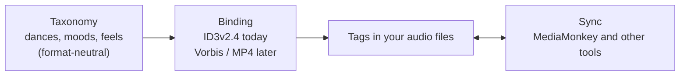

# The music & dance model

SDTS describes a track along a handful of axes a social-dance DJ actually reasons about — not by
file format. The **values** for each axis come from the [vocabulary](vocabulary/README.md); *how*
they are stored in a file is a separate concern (see [Build with it](../README.md#build-with-it)).

## The axes

| Axis | The question it answers | Why it matters on the floor |
|------|-------------------------|-----------------------------|
| **[Which dance, and when](../standard/fields/README.md#which-dance-and-when)** | Which social dances does this track serve, and for what occasion? | The library is filtered into per-dance pools — "give me Lindy at 180", "a blues set". Genre alone can't answer this. |
| **[Tempo & groove](../standard/fields/README.md#tempo-and-groove)** | How fast, and what feel within that speed? | Two records at the same BPM can be different dances. Feel (swung vs shuffle vs slow-drag) is the lever beyond tempo. |
| **[Mood & energy](../standard/fields/README.md#mood-and-energy)** | What does it feel like, and how hard does it drive the room? | Pacing the night: opener → builder → peak → cool-down, without jarring jumps. |
| **[Sound & ensemble](../standard/fields/README.md#sound-and-ensemble)** | What is the music, and who plays it? | Texture and variety — big-band weight vs a small combo, instrumental vs vocal, avoiding three sax features in a row. |
| **[Recording character](../standard/fields/README.md#recording-character)** | How and when was it captured? | Authenticity vs sound-system impact — a noisy 78 reads vintage but thins out on a big PA. |
| **[Structure & cueing](../standard/fields/README.md#structure-and-cueing)** | What shape is the track, and where should it start and stop? | Tight transitions and routine matching — skip a talky intro, cut a long fade, hit the AABA breaks. |

A seventh group, **[Workflow & trust](../standard/fields/README.md#workflow-and-trust)** (rating, confirmation
gates, schema version), is the curation layer — how a DJ keeps a hand-verified library from being
overwritten by automation.

## Two ideas worth knowing

- **Dance ≠ genre.** *Genre* is what the music **is** (Swing, Chicago Blues); *dance* is what it's **for**
  on the floor. The same Swing record may be Lindy-only or also Balboa depending on tempo and feel — so
  danceability is its own axis.
- **Shorthand resolves to one canonical name.** A DJ may type `#LH`, `LH`, or `Lindy`; all resolve to
  **Lindy Hop**. The [vocabulary](vocabulary/README.md) lists every canonical value and its aliases.

## How the layers fit

## Where to go next

- **[Vocabulary](vocabulary/README.md)** — the actual values: every dance with its tempo band, the mood grid, the genres.
- **[Field reference](../standard/fields/README.md)** — one page per field (meaning, values, examples).
- **[Build with it](../README.md#build-with-it)** — for developers: how the tags are stored, synced, and validated.
