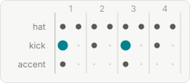
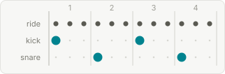
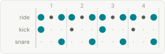
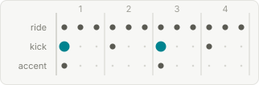
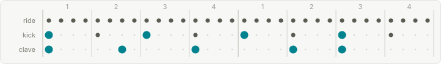
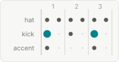
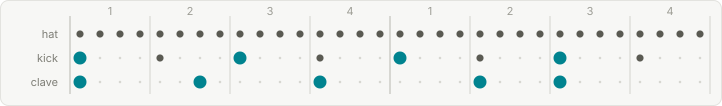
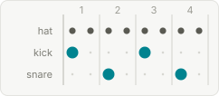
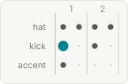
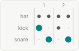

# Rhythmic Feel

The **rhythmic feel** vocabulary — each value's canonical name (what is stored), the aliases that resolve to it, and the axes that make it queryable.

→ Field reference: [Rhythmic Feel](../../standard/fields/sdts/rhythmic_feel.md) · [all dimensions](README.md) · [dances](dances.md)

Axes — **pulse** ([2](#ax-pulse-2), [3](#ax-pulse-3), [4](#ax-pulse-4), [mixed](#ax-pulse-mixed)); **subdivision** ([straight](#ax-subdivision-straight), [triplet](#ax-subdivision-triplet), [bass-feel](#ax-subdivision-bass-feel), [mixed](#ax-subdivision-mixed)); **accent** ([on-beat](#ax-accent-on-beat), [off-beat](#ax-accent-off-beat), [backbeat](#ax-accent-backbeat), [clave](#ax-accent-clave), [none](#ax-accent-none)); **cluster** (swing, bass-line, shuffle, compound-triplet, straight, waltz, latin, brazilian, march, tango).

Grouped by **dance scene** — each feel appears under the scene(s) whose dances use it, anchor feels first; importance is scene-relative, so there is no global tier.

## Swing

### 🥁 Backbeat `BKB`

pulse: [4](#ax-pulse-4) · subdiv: [straight](#ax-subdivision-straight) · accent: [backbeat](#ax-accent-backbeat)

Straight 8ths over 4 beats with the snare accenting beats 2 and 4 while the kick plays 1 and 3, the signature rock & roll, rockabilly and R&B feel.

**Distinguishing trait**

| vs | how it differs |
|---|---|
| **Shuffle** | it is straight (not triplet) and defined by its 2-and-4 snare accent rather than an internal subdivision. |

🔊 **Hear it** — [synthesized rhythm](../../audio/rhythmic_feel/backbeat.mp3) · [MIDI](../../audio/rhythmic_feel/backbeat.mid)

▶ **On record** — [Chuck Berry — Johnny B. Goode](https://www.youtube.com/watch?v=uFeZ_x--aRg)

Aliases: 2-and-4 · Snare Backbeat

### 🎹 Boogie Shuffle `BGE`

pulse: [4](#ax-pulse-4) · subdiv: [straight](#ax-subdivision-straight) · accent: [on-beat](#ax-accent-on-beat)

The piano left hand (or bass) drives eight even straight 8th notes per bar ('8 to the bar') as a rolling motor, the signature of boogie-woogie.

**Distinguishing trait:** despite its name it is straight, not triplet like Shuffle, and uses eight notes per bar rather than the four of Walking 4.

🔊 **Hear it** — [synthesized rhythm](../../audio/rhythmic_feel/boogie-shuffle.mp3) · [MIDI](../../audio/rhythmic_feel/boogie-shuffle.mid)

▶ **On record** — [Pine Top Smith — Pine Top's Boogie Woogie](https://www.youtube.com/watch?v=BYrcZp7Pdh8)

Aliases: Boogie · Boogie 8-to-bar · 8-to-the-bar · 8 to the Bar · Boogie Slow · Rockabilly Piano

### 🎷 Jazz Swing 8ths `SW8`

pulse: [4](#ax-pulse-4) · subdiv: [triplet](#ax-subdivision-triplet) · accent: [off-beat](#ax-accent-off-beat)

The 8th notes are swung in a triplet feel (first 8th ~2/3, second ~1/3 of a triplet), giving a light bouncing pulse over 4 beats per bar; it is the foundational feel of the swing era.

**Distinguishing trait:** lighter and less accented than Shuffle (jazz context vs. blues), and unlike Straight 4 the 8ths are uneven.

🔊 **Hear it** — [synthesized rhythm](../../audio/rhythmic_feel/jazz-swing-8ths.mp3) · [MIDI](../../audio/rhythmic_feel/jazz-swing-8ths.mid)

▶ **On record** — [Benny Goodman — Sing, Sing, Sing](https://www.youtube.com/watch?v=FS0JOTmiieo)

Aliases: Swing 8ths · Swing · Jazz Swing · Swung 8ths · Swinging

### ⚡ Jump Shuffle `JMP`

pulse: [4](#ax-pulse-4) · subdiv: [triplet](#ax-subdivision-triplet) · accent: [backbeat](#ax-accent-backbeat)

An uptempo, driving shuffle with an emphasized backbeat and punchy horn riffs, the bridge feel of jump blues and early R&B (Louis Jordan, Big Joe Turner).

**Distinguishing trait**

| vs | how it differs |
|---|---|
| **plain Shuffle** | it is the faster, horn-driven variant |
| **Boogie Shuffle** | it rides a walking bass and horn hooks rather than a boogie-woogie bass pattern. |

🔊 **Hear it** — [synthesized rhythm](../../audio/rhythmic_feel/jump-shuffle.mp3) · [MIDI](../../audio/rhythmic_feel/jump-shuffle.mid)

▶ **On record** — [Louis Jordan — Caldonia](https://www.youtube.com/watch?v=PR6pHtiNT_k)

Aliases: Jump-Blues Shuffle

### ✂️ Two-Beat `2BT`

pulse: [2](#ax-pulse-2) · subdiv: [bass-feel](#ax-subdivision-bass-feel) · accent: [on-beat](#ax-accent-on-beat)

A pre-swing 'oom-pah' feel that stresses beats 1 and 3 in 4/4, with the bass on the roots and banjo/guitar on the afterbeats, characteristic of Dixieland, ragtime and New Orleans hot jazz.

**Distinguishing trait**

| vs | how it differs |
|---|---|
| **Jazz Swing 8ths** | it is bouncier, more duple and less legato (1927 Armstrong Hot Five vs 1937 Goodman big band). |

🔊 **Hear it** — [synthesized rhythm](../../audio/rhythmic_feel/two-beat.mp3) · [MIDI](../../audio/rhythmic_feel/two-beat.mid)

▶ **On record** — [Louis Armstrong and His Hot Seven — Potato Head Blues](https://www.youtube.com/watch?v=65SBsF28dnc)

Aliases: Two Beat · 2-Beat · 2 Beat · Cut Time · Cut-Time · Alla Breve · Early Swing · Ragtime Two-Beat · Ragtime syncopation

### 🚶 Walking 4 `WLK`

pulse: [4](#ax-pulse-4) · subdiv: [bass-feel](#ax-subdivision-bass-feel) · accent: [on-beat](#ax-accent-on-beat)

A 4-beat bass feel where the bass line plays a melodic note on every beat (four quarter notes per bar), often with chromatic walk-ups, rather than skipping beats.

**Distinguishing trait**

| vs | how it differs |
|---|---|
| **Cut Time** | the bass walks all four beats instead of hitting only 1 and 3; it is orthogonal to swing subdivision and usually layered with Jazz Swing 8ths. |

🔊 **Hear it** — [synthesized rhythm](../../audio/rhythmic_feel/walking-4.mp3) · [MIDI](../../audio/rhythmic_feel/walking-4.mid)

▶ **On record** — [Count Basie — One O'Clock Jump](https://www.youtube.com/watch?v=g3JyQnYPkZk)

Aliases: Walking · Walking Bass · Four-on-the-floor (jazz)

### 🎸 Manouche Swing `MAN`

pulse: [4](#ax-pulse-4) · subdiv: [triplet](#ax-subdivision-triplet) · accent: [backbeat](#ax-accent-backbeat)

The gypsy-jazz 'la pompe' rhythm-guitar technique: two or more rhythm guitars strum all four beats with an alternating down-up chop to create nonstop drive without drums.

**Distinguishing trait**

| vs | how it differs |
|---|---|
| **Jazz Swing 8ths** | it is a specific rhythm-guitar technique (rather than the melodic swing of soloists) and carries a subtle swing bias absent from a perfectly even Straight 4. |

🔊 **Hear it** — [synthesized rhythm](../../audio/rhythmic_feel/manouche-swing.mp3) · [MIDI](../../audio/rhythmic_feel/manouche-swing.mid)

▶ **On record** — [Django Reinhardt — Minor Swing](https://www.youtube.com/watch?v=uTlo809EIlo)

Aliases: Pompé · Gypsy Swing · Django Swing

### 🕺 Rockabilly `RKB`

pulse: [4](#ax-pulse-4) · subdiv: [triplet](#ax-subdivision-triplet) · accent: [backbeat](#ax-accent-backbeat)

A triplet-leaning shuffle with a slapping upright bass and a driving backbeat, the 1950s country-meets-rock-and-roll feel of early Sun Records (Carl Perkins, early Elvis).

**Distinguishing trait**

| vs | how it differs |
|---|---|
| **Backbeat** | it carries a shuffle bias and a slap-bass attack rather than straight 8ths |
| **Boogie Shuffle** | it is guitar-and-slap-bass rather than boogie-piano driven. |

🔊 **Hear it** — [synthesized rhythm](../../audio/rhythmic_feel/rockabilly.mp3) · [MIDI](../../audio/rhythmic_feel/rockabilly.mid)

▶ **On record** — [Carl Perkins — Blue Suede Shoes](https://www.youtube.com/watch?v=I-LH_cMVzEA)

### ⬛ Straight 4 `STG`

pulse: [4](#ax-pulse-4) · subdiv: [straight](#ax-subdivision-straight) · accent: [on-beat](#ax-accent-on-beat)

Even, non-swung 8th notes over a 4-beat pulse, with no triplet feel, common in bebop, cool/modal jazz and Latin jazz.

**Distinguishing trait**

| vs | how it differs |
|---|---|
| **Jazz Swing 8ths** | the 8ths are all equal length (a metronomic 'da-da-da-da' rather than the swung 'ne-ke-den'). |

🔊 **Hear it** — [synthesized rhythm](../../audio/rhythmic_feel/straight-4.mp3) · [MIDI](../../audio/rhythmic_feel/straight-4.mid)

▶ **On record** — [Miles Davis — So What](https://www.youtube.com/watch?v=ylXk1LBvIqU)

Aliases: Straight 4/4 · Four-on-the-floor · Electronic 4-on-the-floor

### 👣 Stride `STR`

pulse: [4](#ax-pulse-4) · subdiv: [bass-feel](#ax-subdivision-bass-feel) · accent: [on-beat](#ax-accent-on-beat)

A solo-piano left-hand feel that alternates a low bass note on beats 1 and 3 with a mid-range chord on beats 2 and 4 ('oom-pah-oom-pah'), rooted in the Harlem stride tradition.

**Distinguishing trait**

| vs | how it differs |
|---|---|
| **Walking 4** | the left hand alternates bass and chord rather than walking a bass note on every beat. |

🔊 **Hear it** — [synthesized rhythm](../../audio/rhythmic_feel/stride.mp3) · [MIDI](../../audio/rhythmic_feel/stride.mid)

▶ **On record** — [Fats Waller — Handful of Keys](https://www.youtube.com/watch?v=kIFoAwJPtm4)

Aliases: Stride Piano

### 💫 Bebop `BOP`

pulse: [4](#ax-pulse-4) · subdiv: [triplet](#ax-subdivision-triplet) · accent: [off-beat](#ax-accent-off-beat)

A fast swung-triplet feel with off-beat accents and a light ride-cymbal pulse, the agile small-group jazz feel of 1940s bebop (Charlie Parker, Dizzy Gillespie).

**Distinguishing trait**

| vs | how it differs |
|---|---|
| **Jazz Swing 8ths** | it runs faster and more virtuosic with sharper off-beat phrasing |
| **Hard Bop Swing** | it is lighter and less blues/gospel-inflected. |

🔊 **Hear it** — [synthesized rhythm](../../audio/rhythmic_feel/bebop.mp3) · [MIDI](../../audio/rhythmic_feel/bebop.mid)

▶ **On record** — [Charlie Parker — Ornithology (1946)](https://www.youtube.com/watch?v=BUHwR-khV20)

Aliases: Be-Bop

### 🔥 Hard Bop Swing `HBP`

pulse: [4](#ax-pulse-4) · subdiv: [triplet](#ax-subdivision-triplet) · accent: [off-beat](#ax-accent-off-beat)

A swung-triplet feel with off-beat accents carrying a heavier blues-and-gospel groove, the soulful 1950s-60s development of bebop (Art Blakey, Horace Silver).

**Distinguishing trait**

| vs | how it differs |
|---|---|
| **Bebop** | it is more grounded with a stronger blues/gospel pocket rather than fast, light bebop phrasing. |

🔊 **Hear it** — [synthesized rhythm](../../audio/rhythmic_feel/hard-bop.mp3) · [MIDI](../../audio/rhythmic_feel/hard-bop.mid)

▶ **On record** — [Art Blakey & the Jazz Messengers — Moanin'](https://www.youtube.com/watch?v=Cv9NSR-2DwM)

Aliases: Hard Bop

## Blues

### 💙 Blues Shuffle `BLS`

pulse: [4](#ax-pulse-4) · subdiv: [triplet](#ax-subdivision-triplet) · accent: [backbeat](#ax-accent-backbeat)

The unmarked mid-tempo triplet shuffle with a backbeat that underpins most twelve-bar blues, the default blues-dance shuffle feel.

**Distinguishing trait:** vs the parent Shuffle it is explicitly blues-scoped rather than the jump/Chicago archetype, and vs the regional variants (Chicago, Delta, Piedmont, NOLA, Swamp) it carries no specific scene, so use it when no regional flavor is identified.

🔊 **Hear it** — [synthesized rhythm](../../audio/rhythmic_feel/blues-shuffle.mp3) · [MIDI](../../audio/rhythmic_feel/blues-shuffle.mid)

▶ **On record** — [B.B. King — Everyday I Have the Blues (Live at the Regal, 1964)](https://www.youtube.com/watch?v=u8AIFxp1euM)

### 🏙️ Chicago Shuffle `CHI`

pulse: [4](#ax-pulse-4) · subdiv: [triplet](#ax-subdivision-triplet) · accent: [backbeat](#ax-accent-backbeat)

A medium-tempo electric-blues shuffle with triplet 8ths and a hard backbeat, the band-tight ensemble groove of post-war Chicago blues (Muddy Waters, Little Walter).

**Distinguishing trait**

| vs | how it differs |
|---|---|
| **generic Shuffle** | it is the amplified, full-band Chicago variant |
| **Jump Shuffle** | it sits slower and is guitar/harmonica-led rather than horn-driven. |

🔊 **Hear it** — [synthesized rhythm](../../audio/rhythmic_feel/chicago-shuffle.mp3) · [MIDI](../../audio/rhythmic_feel/chicago-shuffle.mid)

▶ **On record** — [Little Walter — My Babe](https://www.youtube.com/results?search_query=Little%20Walter%20My%20Babe)

### 🌀 Compound Triplet `C12`

pulse: [4](#ax-pulse-4) · subdiv: [triplet](#ax-subdivision-triplet) · accent: [on-beat](#ax-accent-on-beat)

A slow rolling 12/8 feel where each of the 4 felt beats divides into three even 8ths, giving a long, swaying, smooth character (slow blues ballads, doo-wop, gospel).

**Distinguishing trait:** smooth and rolling rather than Shuffle's hard bounce, with gentle on-beat accents instead of a heavy backbeat.

🔊 **Hear it** — [synthesized rhythm](../../audio/rhythmic_feel/compound-triplet.mp3) · [MIDI](../../audio/rhythmic_feel/compound-triplet.mid)

▶ **On record** — [Etta James — At Last](https://www.youtube.com/watch?v=1qJU8G7gR_g)

Aliases: 12/8 · Slow 12/8 · Rolling Triplet · 12-8 · 12-8 Feel

### 🐌 Slow Drag `SDR`

pulse: [4](#ax-pulse-4) · subdiv: [triplet](#ax-subdivision-triplet) · accent: [backbeat](#ax-accent-backbeat)

A very slow triplet/shuffle feel (roughly 40-75 BPM) with soft, held-back accents, the signature blues-dance feel for intimate slow socials.

**Distinguishing trait:** shares Shuffle's triplet subdivision but is set apart primarily by its much slower tempo and gentler, non-bouncy intensity.

🔊 **Hear it** — [synthesized rhythm](../../audio/rhythmic_feel/slow-drag.mp3) · [MIDI](../../audio/rhythmic_feel/slow-drag.mid)

▶ **On record** — [T-Bone Walker — (Call It) Stormy Monday](https://www.youtube.com/watch?v=VAPDJheC0Jk)

Aliases: Slow Blues Shuffle · Slow Blues

### 💜 Soul Shuffle `SOU`

pulse: [4](#ax-pulse-4) · subdiv: [mixed](#ax-subdivision-mixed) · accent: [backbeat](#ax-accent-backbeat)

A shuffle with a mixed straight/triplet feel and a firm backbeat, blending a soul/R&B horn-and-organ sensibility into the groove (1960s-70s soul).

**Distinguishing trait**

| vs | how it differs |
|---|---|
| **Blues Shuffle** | it carries a smoother soul phrasing and its subdivision is mixed rather than strictly triplet |
| **R** | &B Shuffle it leans warmer and more polished. |

🔊 **Hear it** — [synthesized rhythm](../../audio/rhythmic_feel/soul-shuffle.mp3) · [MIDI](../../audio/rhythmic_feel/soul-shuffle.mid)

▶ **On record** — [Wilson Pickett — Mustang Sally](https://www.youtube.com/watch?v=T_uSM-i_c_I)

- **Jazz Swing 8ths** `SW8` — also danced here; see [Swing](#feel-jazz-swing-8ths).

### ⚜️ NOLA Shuffle `NLA`

pulse: [4](#ax-pulse-4) · subdiv: [triplet](#ax-subdivision-triplet) · accent: [backbeat](#ax-accent-backbeat)

A New Orleans shuffle with triplet 8ths and a backbeat, carrying a loose, syncopated street-parade lilt rooted in the city's piano-and-drums tradition (Professor Longhair, Fats Domino).

**Distinguishing trait**

| vs | how it differs |
|---|---|
| **Chicago Shuffle** | it swings looser and more rolling |
| **Second Line** | it is a band shuffle rather than the brass-band parade beat. |

🔊 **Hear it** — [synthesized rhythm](../../audio/rhythmic_feel/nola-shuffle.mp3) · [MIDI](../../audio/rhythmic_feel/nola-shuffle.mid)

▶ **On record** — [Fats Domino — I'm Walkin'](https://www.youtube.com/watch?v=ox5eCN_V9mQ)

Aliases: New Orleans Shuffle

### 🎙️ R&B Shuffle `RNB`

pulse: [4](#ax-pulse-4) · subdiv: [triplet](#ax-subdivision-triplet) · accent: [backbeat](#ax-accent-backbeat)

A triplet shuffle with a strong backbeat in the classic rhythm-and-blues mold, vocal-forward with horns and a danceable mid-tempo bounce.

**Distinguishing trait**

| vs | how it differs |
|---|---|
| **Jump Shuffle** | it is slower and less frantic |
| **Soul Shuffle** | it stays strictly triplet rather than mixed. |

🔊 **Hear it** — [synthesized rhythm](../../audio/rhythmic_feel/rb-shuffle.mp3) · [MIDI](../../audio/rhythmic_feel/rb-shuffle.mid)

▶ **On record** — [Ray Charles — What'd I Say](https://www.youtube.com/watch?v=6uTDa3771HM)

Aliases: Rhythm & Blues Shuffle

### 📻 Retro Soul Shuffle `RSO`

pulse: [4](#ax-pulse-4) · subdiv: [mixed](#ax-subdivision-mixed) · accent: [backbeat](#ax-accent-backbeat)

A modern revival of the soul shuffle with a mixed straight/triplet feel and backbeat, recorded to evoke vintage 1960s soul (Daptone-style retro-soul, Sharon Jones, Amy Winehouse).

**Distinguishing trait:** musically near-identical to Soul Shuffle but flagged as a contemporary throwback recording rather than a period-original.

🔊 **Hear it** — [synthesized rhythm](../../audio/rhythmic_feel/retro-soul-shuffle.mp3) · [MIDI](../../audio/rhythmic_feel/retro-soul-shuffle.mid)

▶ **On record** — [Amy Winehouse — Rehab](https://www.youtube.com/watch?v=HoqSO0hAjZw)

### 🛶 Delta Shuffle `DLT`

pulse: [4](#ax-pulse-4) · subdiv: [triplet](#ax-subdivision-triplet) · accent: [backbeat](#ax-accent-backbeat)

A triplet shuffle with a backbeat in the Mississippi Delta acoustic-blues tradition, raw and often loosely metered around a droning slide or fingerpicked guitar (Son House, Robert Johnson lineage).

**Distinguishing trait**

| vs | how it differs |
|---|---|
| **Piedmont Shuffle** | it is darker and heavier with less ragtime syncopation, and rougher than the band-tight Chicago Shuffle. |

🔊 **Hear it** — [synthesized rhythm](../../audio/rhythmic_feel/delta-shuffle.mp3) · [MIDI](../../audio/rhythmic_feel/delta-shuffle.mid)

▶ **On record** — [Robert Johnson — Sweet Home Chicago (1936)](https://www.youtube.com/watch?v=Ug0ZRSbmCRM)

### 🥥 NOLA Rhumba `NRH`

pulse: [4](#ax-pulse-4) · subdiv: [mixed](#ax-subdivision-mixed) · accent: [clave](#ax-accent-clave)

A New Orleans groove with a mixed feel built over a clave/habanera-derived accent, the 'rhumba-boogie' that grafts a Latin tinge onto a rolling NO beat (Professor Longhair).

**Distinguishing trait**

| vs | how it differs |
|---|---|
| **Latin Clave** | it is a New Orleans piano-blues feel using the clave as a flavor rather than a true Afro-Cuban band pattern |
| **NOLA Shuffle** | it rides a Latin accent instead of a straight shuffle. |

🔊 **Hear it** — [synthesized rhythm](../../audio/rhythmic_feel/nola-rhumba.mp3) · [MIDI](../../audio/rhythmic_feel/nola-rhumba.mid)

▶ **On record** — [Professor Longhair — Tipitina](https://www.youtube.com/watch?v=5IILlTLqBOY)

Aliases: Rhumba Boogie · New Orleans Rhumba

### 🏔️ Piedmont Shuffle `PMT`

pulse: [4](#ax-pulse-4) · subdiv: [triplet](#ax-subdivision-triplet) · accent: [backbeat](#ax-accent-backbeat)

A triplet shuffle with a backbeat tied to the East Coast Piedmont blues tradition, built around fingerpicked acoustic guitar with an alternating-bass ragtime lilt (Blind Boy Fuller, Rev. Gary Davis).

**Distinguishing trait**

| vs | how it differs |
|---|---|
| **Delta Shuffle** | it is brighter and more syncopated with a ragtime bounce rather than a heavy, dragging groove. |

🔊 **Hear it** — [synthesized rhythm](../../audio/rhythmic_feel/piedmont-shuffle.mp3) · [MIDI](../../audio/rhythmic_feel/piedmont-shuffle.mid)

▶ **On record** — [Blind Boy Fuller — Step It Up and Go (1940)](https://www.youtube.com/watch?v=M2oIWyr4v7U)

### 🤘 Rock Shuffle `RCK`

pulse: [4](#ax-pulse-4) · subdiv: [triplet](#ax-subdivision-triplet) · accent: [backbeat](#ax-accent-backbeat)

An uptempo triplet shuffle with a heavy backbeat driven by electric guitar and a rock band, the blues-rock shuffle of acts like ZZ Top and Stevie Ray Vaughan.

**Distinguishing trait**

| vs | how it differs |
|---|---|
| **Blues Shuffle** | it is harder and more amplified with a rock attack |
| **Jump Shuffle** | it is guitar-driven rather than horn-driven. |

🔊 **Hear it** — [synthesized rhythm](../../audio/rhythmic_feel/rock-shuffle.mp3) · [MIDI](../../audio/rhythmic_feel/rock-shuffle.mid)

▶ **On record** — [Stevie Ray Vaughan & Double Trouble — Pride and Joy](https://www.youtube.com/watch?v=I3MTGhRC82s)

### 🐊 Swamp Shuffle `SWP`

pulse: [4](#ax-pulse-4) · subdiv: [triplet](#ax-subdivision-triplet) · accent: [backbeat](#ax-accent-backbeat)

A slow, greasy triplet shuffle with a backbeat from the Louisiana swamp-blues tradition, sparse and laid-back with a heavy lazy pocket (Slim Harpo, Lightnin' Slim).

**Distinguishing trait**

| vs | how it differs |
|---|---|
| **Blues Shuffle** | it sits slower and dirtier with a dragging swamp feel |
| **NOLA Shuffle** | it is rural and minimal rather than parade-influenced. |

🔊 **Hear it** — [synthesized rhythm](../../audio/rhythmic_feel/swamp-shuffle.mp3) · [MIDI](../../audio/rhythmic_feel/swamp-shuffle.mid)

▶ **On record** — [Slim Harpo — Baby Scratch My Back](https://www.youtube.com/watch?v=-5x7NIqga8M)

## Tango (Argentine)

### 🌹 Habanera `HAB`

pulse: [2](#ax-pulse-2) · subdiv: [straight](#ax-subdivision-straight) · accent: [clave](#ax-accent-clave)

A 19th-century Cuban bass figure (dotted-8th + 16th + 8th + 8th) repeating in a 2-beat frame, the 'Spanish tinge' that fed early New Orleans jazz, blues and Argentine tango.

**Distinguishing trait**

| vs | how it differs |
|---|---|
| **Latin Clave** | it is a per-bar bass pattern rather than clave's 5-note cross-bar accent pattern. |

🔊 **Hear it** — [synthesized rhythm](../../audio/rhythmic_feel/habanera.mp3) · [MIDI](../../audio/rhythmic_feel/habanera.mid)

▶ **On record** — [Maria Callas — Habanera, Bizet's Carmen](https://www.youtube.com/watch?v=K7BE7trV_oQ)

Aliases: Tango Habanera

### 🪗 Milonga con Traspié `MTR`

pulse: [2](#ax-pulse-2) · subdiv: [straight](#ax-subdivision-straight) · accent: [off-beat](#ax-accent-off-beat)

The playful syncopated milonga with traspié (contratiempo double-steps) over the habanera frame.

**Distinguishing trait**

| vs | how it differs |
|---|---|
| **Habanera** | it adds the off-beat contratiempo lift rather than riding the plain bass cell. |

🔊 **Hear it** — [synthesized rhythm](../../audio/rhythmic_feel/milonga-traspie.mp3) · [MIDI](../../audio/rhythmic_feel/milonga-traspie.mid)

Aliases: Traspié · Contratiempo Milonga

### 🪗 Tango Marcato `TGM`

pulse: [4](#ax-pulse-4) · subdiv: [straight](#ax-subdivision-straight) · accent: [on-beat](#ax-accent-on-beat)

The driving 4/4 pulse marking every beat ('marcato in 4'), the rhythmic backbone of D'Arienzo-style Golden-Age tango.

**Distinguishing trait**

| vs | how it differs |
|---|---|
| **Straight 4** | it is bandoneon-led with a heavy, grounded on-beat marking and rubato phrasing on top. |

🔊 **Hear it** — [synthesized rhythm](../../audio/rhythmic_feel/tango-marcato.mp3) · [MIDI](../../audio/rhythmic_feel/tango-marcato.mid)

Aliases: Marcato · Marcato in 4

### 🪗 Tango Vals `TVL`

pulse: [3](#ax-pulse-3) · subdiv: [straight](#ax-subdivision-straight) · accent: [on-beat](#ax-accent-on-beat)

A continuously-flowing 3/4 tango-waltz lilt felt one-per-bar with a strong beat 1, tied to Golden-Age valses.

**Distinguishing trait**

| vs | how it differs |
|---|---|
| **Waltz** | it is faster and more circular, stepping on accented beats across the bar rather than a square ONE-two-three. |

🔊 **Hear it** — [synthesized rhythm](../../audio/rhythmic_feel/tango-vals.mp3) · [MIDI](../../audio/rhythmic_feel/tango-vals.mid)

Aliases: Vals Cruzado

### 🪗 Tango Síncopa `TSC`

pulse: [2](#ax-pulse-2) · subdiv: [straight](#ax-subdivision-straight) · accent: [off-beat](#ax-accent-off-beat)

The sharp syncopated/staccato tango accent displacing weight onto the off-beat over a 2-felt marcato frame (D'Arienzo, Biagi).

**Distinguishing trait**

| vs | how it differs |
|---|---|
| **Tango Marcato** | it crisply hits the '1-and' off-beat rather than every even beat. |

🔊 **Hear it** — [synthesized rhythm](../../audio/rhythmic_feel/tango-sincopa.mp3) · [MIDI](../../audio/rhythmic_feel/tango-sincopa.mid)

Aliases: Síncopa · Tango Staccato

- **Waltz** `WLZ` — also danced here; see [Ballroom (International)](#feel-waltz).

## Ballroom (International)

### 🕺 Bolero-Rumba `BLR`

pulse: [4](#ax-pulse-4) · subdiv: [straight](#ax-subdivision-straight) · accent: [clave](#ax-accent-clave)

A slow, romantic Cuban 4/4 on a gentle cinquillo/clave — the ballad feel the ballroom Rumba is danced to.

**Distinguishing trait**

| vs | how it differs |
|---|---|
| **Compound Triplet** | it rests on a Cuban cinquillo rather than a 12/8 roll |
| **Latin Clave** | it is slow and lyrical. |

🔊 **Hear it** — [synthesized rhythm](../../audio/rhythmic_feel/bolero-rumba.mp3) · [MIDI](../../audio/rhythmic_feel/bolero-rumba.mid)

Aliases: Bolero Feel

### 🕺 Paso Doble March `PDM`

pulse: [2](#ax-pulse-2) · subdiv: [straight](#ax-subdivision-straight) · accent: [on-beat](#ax-accent-on-beat)

A Spanish 2/4 military-march feel (the 'España cañí' cadence) for the ballroom Paso Doble.

**Distinguishing trait**

| vs | how it differs |
|---|---|
| **Two-Beat** | it carries a flamenco-tinged Spanish march phrasing built around dramatic accents and halts. |

🔊 **Hear it** — [synthesized rhythm](../../audio/rhythmic_feel/paso-doble-march.mp3) · [MIDI](../../audio/rhythmic_feel/paso-doble-march.mid)

Aliases: España Cañí

### 💃 Viennese Waltz `VWZ`

pulse: [3](#ax-pulse-3) · subdiv: [straight](#ax-subdivision-straight) · accent: [on-beat](#ax-accent-on-beat)

A fast rotary 3/4 (~58 mpm) felt one-per-bar, driving continuous natural/reverse turns.

**Distinguishing trait**

| vs | how it differs |
|---|---|
| **Waltz** | the felt unit is the whole bar, not the individual beat — you swing once per measure, not three times. |

🔊 **Hear it** — [synthesized rhythm](../../audio/rhythmic_feel/viennese-waltz.mp3) · [MIDI](../../audio/rhythmic_feel/viennese-waltz.mid)

Aliases: Quick Waltz Feel

### 💃 Waltz `WLZ`

pulse: [3](#ax-pulse-3) · subdiv: [straight](#ax-subdivision-straight) · accent: [on-beat](#ax-accent-on-beat)

A 3-beats-per-bar pulse ('ONE-two-three') with a strong downbeat, drawn from European ballroom tradition and adopted into jazz from the 1950s onward.

**Distinguishing trait:** its unmistakable triple meter (not 4 or 2 beats) makes it rarely confused with any other feel.

🔊 **Hear it** — [synthesized rhythm](../../audio/rhythmic_feel/waltz.mp3) · [MIDI](../../audio/rhythmic_feel/waltz.mid)

▶ **On record** — [Norah Jones — Come Away With Me](https://www.youtube.com/watch?v=lbjZPFBD6JU)

Aliases: 3/4 · Slow Waltz

- **Backbeat** `BKB` — also danced here; see [Swing](#feel-backbeat).

- **Cha-Cha-Chá** `CHA` — also danced here; see [Street Latin](#feel-cha-cha-cha).

- **Habanera** `HAB` — also danced here; see [Tango (Argentine)](#feel-habanera).

- **Jazz Swing 8ths** `SW8` — also danced here; see [Swing](#feel-jazz-swing-8ths).

- **Jump Shuffle** `JMP` — also danced here; see [Swing](#feel-jump-shuffle).

- **Latin Clave** `CLV` — also danced here; see [Street Latin](#feel-latin-clave).

- **Samba (Batucada)** `SMB` — also danced here; see [Street Latin](#feel-samba-batucada).

- **Tango Marcato** `TGM` — also danced here; see [Tango (Argentine)](#feel-tango-marcato).

- **Two-Beat** `2BT` — also danced here; see [Swing](#feel-two-beat).

- **Walking 4** `WLK` — also danced here; see [Swing](#feel-walking-4).

### 🏖️ Bossa Nova `BSA`

pulse: [2](#ax-pulse-2) · subdiv: [straight](#ax-subdivision-straight) · accent: [clave](#ax-accent-clave)

A Brazilian feel derived from samba crossed with cool jazz: a syncopated guitar chord pattern over a steady, quiet bass in a flowing 2/4 pulse.

**Distinguishing trait**

| vs | how it differs |
|---|---|
| **Latin Clave** | it is Brazilian 2/4 (not Cuban 4/4) |
| **Straight 4** | it is 2-pulse with an identifying bossa guitar comp. |

🔊 **Hear it** — [synthesized rhythm](../../audio/rhythmic_feel/bossa-nova.mp3) · [MIDI](../../audio/rhythmic_feel/bossa-nova.mid)

▶ **On record** — [Stan Getz feat. Astrud Gilberto — The Girl from Ipanema](https://www.youtube.com/watch?v=s61-e29Vr6Q)

Aliases: Bossa · Brazilian

## Street Latin

### 🎸 Bachata (Derecho) `BAC`

pulse: [4](#ax-pulse-4) · subdiv: [straight](#ax-subdivision-straight) · accent: [backbeat](#ax-accent-backbeat)

A Dominican 4/4 led by the requinto guitar with a bongo/güira pulse and the dance's tap on beat 4.

**Distinguishing trait**

| vs | how it differs |
|---|---|
| **Bolero-Rumba** | it is guitar-driven, faster and backbeat-leaning rather than a slow clave ballad. |

🔊 **Hear it** — [synthesized rhythm](../../audio/rhythmic_feel/bachata-derecho.mp3) · [MIDI](../../audio/rhythmic_feel/bachata-derecho.mid)

Aliases: Bachata Feel

### 🕺 Cha-Cha-Chá `CHA`

pulse: [4](#ax-pulse-4) · subdiv: [straight](#ax-subdivision-straight) · accent: [on-beat](#ax-accent-on-beat)

A clave-based Cuban 4/4 with the signature triple-step landing on 4-and-1.

**Distinguishing trait**

| vs | how it differs |
|---|---|
| **Latin Clave** | it is squarer and more on-beat, defined by the güiro and the 4-&-1 cha-cha-cha triple rather than the son tumbao. |

🔊 **Hear it** — [synthesized rhythm](../../audio/rhythmic_feel/cha-cha-cha.mp3) · [MIDI](../../audio/rhythmic_feel/cha-cha-cha.mid)

Aliases: Cha Cha Feel

### 🫂 Kizomba `KIZ`

pulse: [4](#ax-pulse-4) · subdiv: [straight](#ax-subdivision-straight) · accent: [on-beat](#ax-accent-on-beat)

A slow Angolan 4/4 (~80-110 BPM) derived from semba — a smooth, grounded pulse emphasising connection over subdivision.

**Distinguishing trait**

| vs | how it differs |
|---|---|
| **Zouk-Lambada** | it is slower and more grounded with a steady African pulse rather than lambada syncopation. |

🔊 **Hear it** — [synthesized rhythm](../../audio/rhythmic_feel/kizomba.mp3) · [MIDI](../../audio/rhythmic_feel/kizomba.mid)

Aliases: Kizomba Feel

### 🪘 Latin Clave `CLV`

pulse: [4](#ax-pulse-4) · subdiv: [straight](#ax-subdivision-straight) · accent: [clave](#ax-accent-clave)

An Afro-Cuban 5-note rhythmic pattern spanning a 2-bar cycle (son/rumba clave) that organizes the whole band, the foundation of son, salsa, mambo and Latin jazz.

**Distinguishing trait**

| vs | how it differs |
|---|---|
| **Habanera** | it is a 20th-century cross-bar accent pattern rather than a per-bar bass figure, and it is Cuban 4/4 rather than Brazilian (Bossa Nova). |

🔊 **Hear it** — [synthesized rhythm](../../audio/rhythmic_feel/latin-clave.mp3) · [MIDI](../../audio/rhythmic_feel/latin-clave.mid)

▶ **On record** — [Tito Puente — Oye Como Va](https://www.youtube.com/watch?v=BpAXzTpANNw)

Aliases: Clave · Son Clave · Rumba Clave · Latin · Mambo

### 🥁 Merengue `MRG`

pulse: [2](#ax-pulse-2) · subdiv: [straight](#ax-subdivision-straight) · accent: [on-beat](#ax-accent-on-beat)

A fast Dominican 2/4 march built on the tambora drum and güira scrape — an even, driving two-step.

**Distinguishing trait**

| vs | how it differs |
|---|---|
| **Two-Beat** | its tambora/güira instrumentation and clave-free straight march set it apart from the jazz oom-pah. |

🔊 **Hear it** — [synthesized rhythm](../../audio/rhythmic_feel/merengue.mp3) · [MIDI](../../audio/rhythmic_feel/merengue.mid)

Aliases: Merengue Feel

### 🥁 Samba (Batucada) `SMB`

pulse: [2](#ax-pulse-2) · subdiv: [straight](#ax-subdivision-straight) · accent: [off-beat](#ax-accent-off-beat)

A Brazilian 2/4 surdo-and-tamborim battery with a strong 'two' and busy 16th-note off-beats — the engine of street and ballroom samba.

**Distinguishing trait**

| vs | how it differs |
|---|---|
| **Bossa Nova** | it is a full high-energy percussion battery rather than bossa's whispered guitar comp. |

🔊 **Hear it** — [synthesized rhythm](../../audio/rhythmic_feel/samba-batucada.mp3) · [MIDI](../../audio/rhythmic_feel/samba-batucada.mid)

Aliases: Samba Feel · Batucada

### 🕺 Zouk-Lambada `ZLB`

pulse: [4](#ax-pulse-4) · subdiv: [straight](#ax-subdivision-straight) · accent: [backbeat](#ax-accent-backbeat)

A Brazilian-zouk 4/4 with a slow, syncopated tum-tum-tchi spread across the bar for flowing body-wave movement.

**Distinguishing trait**

| vs | how it differs |
|---|---|
| **Kizomba** | it is lambada-derived with long count-and-a syncopation rather than a grounded steady pulse. |

🔊 **Hear it** — [synthesized rhythm](../../audio/rhythmic_feel/zouk-lambada.mp3) · [MIDI](../../audio/rhythmic_feel/zouk-lambada.mid)

Aliases: Brazilian Zouk Feel

- **Bolero-Rumba** `BLR` — also danced here; see [Ballroom (International)](#feel-bolero-rumba).

- **Habanera** `HAB` — also danced here; see [Tango (Argentine)](#feel-habanera).

## Cross-genre & listening (no anchoring dance)

Feels with no social dance in the current packs — a flavour or listening groove, not a floor feel.

### 🔀 Shuffle `SHF`

pulse: [4](#ax-pulse-4) · subdiv: [triplet](#ax-subdivision-triplet) · accent: [backbeat](#ax-accent-backbeat)

Triplet 8ths with the accent on the second 8th of each pair (the 'and'), producing a heavy, bouncy, dragging-and-jumping groove that is the backbone of jump and Chicago blues.

**Distinguishing trait:** heavier and more accented than Jazz Swing 8ths, and triplet rather than the straight 8-to-the-bar of Boogie Shuffle.

🔊 **Hear it** — [synthesized rhythm](../../audio/rhythmic_feel/shuffle.mp3) · [MIDI](../../audio/rhythmic_feel/shuffle.mid)

▶ **On record** — [Louis Jordan & His Tympany Five — Choo Choo Ch'Boogie](https://www.youtube.com/watch?v=P1EG__jgefA)

Aliases: Bouncy Shuffle

### 🎺 Second Line `2LN`

pulse: [4](#ax-pulse-4) · subdiv: [straight](#ax-subdivision-straight) · accent: [backbeat](#ax-accent-backbeat)

The specific New Orleans brass-band parade/procession drum feel: kick on 1 and 3 with a syncopated street-beat snare and dominant bass drum, played by a brass ensemble.

**Distinguishing trait**

| vs | how it differs |
|---|---|
| **Cut Time** | it is the genre-specific NO variant identified by sousaphone/tuba bass, brass-band instrumentation and the syncopated snare. |

🔊 **Hear it** — [synthesized rhythm](../../audio/rhythmic_feel/second-line.mp3) · [MIDI](../../audio/rhythmic_feel/second-line.mid)

▶ **On record** — [Rebirth Brass Band — When the Saints Go Marching In](https://www.youtube.com/watch?v=iDaneKADnZw)

Aliases: NOLA Second Line · Second-Line

### 🤠 Two-step `2ST`

pulse: [4](#ax-pulse-4) · subdiv: [straight](#ax-subdivision-straight) · accent: [on-beat](#ax-accent-on-beat)

A country/western feel with a walking bass on all four beats and straight 8ths, the predictable groove of Bob Wills-era western swing.

**Distinguishing trait:** musically close to Walking 4 but set apart by its country context and instrumentation (fiddle, steel guitar, country vocals) rather than jazz.

🔊 **Hear it** — [synthesized rhythm](../../audio/rhythmic_feel/two-step.mp3) · [MIDI](../../audio/rhythmic_feel/two-step.mid)

▶ **On record** — [Bob Wills & His Texas Playboys — Take Me Back to Tulsa](https://www.youtube.com/watch?v=dxDacEgmMpo)

Aliases: Country Two-Step · Two Step

### 🐎 Western Swing Shuffle `WSW`

pulse: [4](#ax-pulse-4) · subdiv: [triplet](#ax-subdivision-triplet) · accent: [backbeat](#ax-accent-backbeat)

An uptempo triplet shuffle with a backbeat from the western-swing tradition, swung jazz feel played on fiddle and steel guitar with a country accent (Bob Wills and the Texas Playboys).

**Distinguishing trait**

| vs | how it differs |
|---|---|
| **Jump Shuffle** | it carries country/western instrumentation rather than horns |
| **Two-step** | it is a swung shuffle rather than straight 8ths. |

🔊 **Hear it** — [synthesized rhythm](../../audio/rhythmic_feel/western-swing-shuffle.mp3) · [MIDI](../../audio/rhythmic_feel/western-swing-shuffle.mid)

▶ **On record** — [Bob Wills & the Texas Playboys — Take Me Back to Tulsa](https://www.youtube.com/watch?v=dxDacEgmMpo)

Aliases: Western Shuffle

## Axis reference

**Pulse**

- `2` — Two felt beats per bar — a duple, marching ONE-two pulse (polka, two-beat, habanera).
- `3` — Three felt beats per bar — the waltz pulse, ONE-two-three.
- `4` — Four felt beats per bar — the default social-dance pulse, counted in fours.
- `mixed` — The felt pulse shifts or layers across the track — count by the felt beat, not a fixed bar.

**Subdivision**

- `straight` — Each beat divides into even halves — un-swung 8th notes (da-da-da-da).
- `triplet` — Each beat divides into three — the swung/shuffle lilt where paired 8ths fall long-short.
- `bass-feel` — The motion is carried by a bass line walking or striding on the beats, not by a hi-hat subdivision.
- `mixed` — A blend of straight and triplet within the track (e.g. a straight bass under a swung top line).

**Accent**

- `on-beat` — Emphasis on the main beats / downbeats — a grounded, even feel.
- `off-beat` — Emphasis on the 'and' between beats — the lifting swing of jazz ride playing.
- `backbeat` — Emphasis on beats 2 and 4 — the snare-driven feel of blues, R&B, rock'n'roll and rockabilly.
- `clave` — Emphasis follows the Afro-Cuban/Brazilian clave — a fixed five-stroke, two-bar key pattern the band locks to.
- `none` — No fixed accent pattern — emphasis is even or left to the players.

_Generated from [`data/vocabulary/`](https://github.com/rokbjc/SocialDanceTaggingStandard/tree/HEAD/data/vocabulary) by `scripts/gen_vocab_docs.py` — do not hand-edit; edit `data/vocabulary/`, then re-run this._
